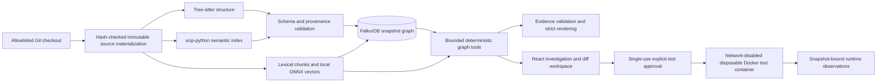

# FalkorDB CodeGraph

CodeGraph is a local Python repository investigation workbench. It helps a developer trace a question such as “what could this change affect?” through source structure, resolver-backed bindings, conservative dispatch candidates, provenance, retrieval passages, Git history, and explicitly approved test observations.

## Why a graph

Search finds similar text, but it cannot establish which definition a call binds to, distinguish an exact binding from a possible runtime target, or preserve a multi-hop path with evidence for every step. CodeGraph stores deterministic relationships in FalkorDB and keeps text retrieval as a separate evidence channel. Each snapshot is immutable and carries source spans, hashes, extractor/rule identity, and replay state. Queries can therefore show both the relationship and where it came from.

## Architecture and evidence boundaries



Syntax identifies a call site; SCIP establishes an exact static binding only when its occurrence joins unambiguously to the source site and definition. `MAY_DISPATCH_TO` records supported possible targets from deterministic hierarchy analysis. It is not a runtime observation. Runtime observations describe behavior seen during one approved test run and do not rewrite static edges. See [architecture](docs/architecture.md) and the [evidence taxonomy](docs/evidence-taxonomy.md).

FalkorDB stores a metadata graph and a separate immutable graph for each analyzed snapshot. Queries and evidence must stay within one `READY` snapshot. The [graph schema](docs/graph-schema.md) documents labels, relationships, indices, and publication checks. For maintainers inspecting FalkorDB directly, these read-only examples illustrate the stored schema; substitute the selected snapshot ID and run them against that snapshot's graph:

```cypher
MATCH (c:CallSite)-[b:BINDS_TO]->(target:SourceEntity)
WHERE c.snapshot_id = $snapshot_id
RETURN c.id AS call_site, c.file_path AS path, c.start_byte AS byte_offset,
       b.binding_state AS binding, target.qualified_name AS target
ORDER BY path, byte_offset, call_site
LIMIT 100
```

```cypher
MATCH (c:CallSite)-[d:MAY_DISPATCH_TO]->(candidate)
WHERE c.snapshot_id = $snapshot_id
RETURN c.id AS call_site, c.dispatch_state AS state,
       candidate.qualified_name AS candidate, d.rule_id AS derivation
ORDER BY call_site, candidate
LIMIT 100
```

Use a bound `$snapshot_id` parameter and a deterministic `ORDER BY` before a result limit. The product API does not accept arbitrary Cypher. See [security](docs/security.md) for the boundary.

## Investigation and validation

The query planner uses deterministic rules plus a local Ollama analyzer (`qwen2.5:0.5b`) on loopback. It sends only the question; typed validation and deterministic route merging prevent the model from removing required routes or calling tools. If Ollama is unavailable or returns invalid output, deterministic planning continues. This is query analysis only: no model generates user-facing answers, and validated claims still require server-produced evidence of the right type and snapshot. Strict rendering uses validator-owned wording and reports uncertainty or missing evidence as limitations. See [query planning](docs/query-planning.md), [claim validation](docs/claim-validation.md), and [graph tools](docs/graph-tools.md).

## Local setup

Requirements: Python 3.11, Node.js/npm, Docker with Compose, and Git. Semantic indexing needs the pinned `scip-python` package and SCIP CLI v0.10.0. SCIP CLI installation downloads the platform archive from its upstream GitHub release. The local ONNX embedder downloads its model files on first use and runs on CPU; set `HF_HOME` to choose the cache location.

```sh
cp .env.example .env
python3.11 -m venv .venv
source .venv/bin/activate
python -m pip install -r requirements-py311.lock
python -m pip install --no-deps -e '.[dev,embeddings]'
npm ci
npm run install:scip-cli
```

Edit `.env` and set `ALLOWED_REPOSITORY_ROOTS` to the absolute parent directory containing the Python repository you want to inspect. It is empty by default: repository operations fail closed until an explicit root is configured. Set `SCIP_PYTHON_BIN` and `SCIP_CLI_BIN` only if the installed tools are elsewhere. For isolated test recommendations and runs, set `RUNTIME_CONTAINER_IMAGE` to a prebuilt image ID or immutable image digest that includes pytest and the target project's test dependencies; CodeGraph never installs those dependencies at runtime.

Start the database and services in separate terminals:

```sh
docker compose up -d --wait falkordb
.venv/bin/uvicorn backend.app.main:app --host 127.0.0.1 --port 8000
```

```sh
npm run dev
```

Open the Vite URL printed by the frontend (normally `http://127.0.0.1:5173`). API and database ports bind to loopback. Static ingestion reads source as data and does not install dependencies or execute repository code.

## Reproducible demo

Follow the [demo runbook](docs/demo-script.md) with the checked-in `ground-truth-v1` fixture or another explicitly allowlisted Python checkout. It walks through ingestion, binding and dispatch evidence, provenance replay, a multi-hop Evidence Path, an unresolved dynamic case, diff analysis, a test plan and its approval boundary, isolated test execution, runtime observations, and the checked-in evaluation reports. It also marks which screens require a separately prepared environment; no metric or unsupported live capability should be implied by the walkthrough.

## Evaluation and performance

Evaluation separates graph quality, retrieval ranking, answer grounding, runtime mapping, and latency. Frozen controlled-fixture and Requests v2.32.5 reports, datasets, thresholds, and reproduction commands are in [docs/evaluation.md](docs/evaluation.md), [the M25 methodology](docs/evaluation/m25-methodology.md), and `reports/`. M25 measured local retrieval Recall@5 0.722, MRR 0.889, and nDCG@10 0.644 on 190 chunks. A local Qwen gold-evidence experiment measured 27/30 exact paths, 21/30 complete paths, 47/63 edge-specific citations, and 3/63 unsupported claims; it is not production answer-generation performance, and the free-form prose was not human-scored. A bounded Requests 2.32.5 runtime diagnostic collected 858 calls (656 mapped, 202 unmapped) and found 17 conflict pairs across 15 sites, with no confirmed static-truth defect in that sample. These are sample measurements, not Requests-wide rates. Hosted embedding calls were not made for M25.

The M26 report records a baseline on a 2018 Intel Mac with 16 GB RAM and the browser-backed Explorer optimization. The measured Graph Explorer transition was 2,649 ms before and 797 ms median after across seven transitions. The after P95 was 1,498 ms. These are measurements for the documented host and workload, not general hardware guarantees; see [the M26 report](docs/evaluation/m26-performance.md).

## Security and limitations

- Repository paths require an explicit allowlist; API and FalkorDB bind to loopback for local use.
- Ingestion parses source but does not execute setup scripts or install project dependencies.
- Runtime pytest collection and execution require a visible single-use approval and run in a disposable, network-disabled Docker container with a read-only snapshot, fixed command, and resource/time/output bounds.
- Hosted embeddings are disabled by default and require explicit opt-in, selected snapshot evidence, secret scanning, and a preflight cost limit. An API key alone does not authorize transmission.
- Runtime observations are useful CodeGraph-managed evidence for ordinary OSS repositories; they are not authenticated against deliberate tampering by malicious repository code and never become static graph facts.
- V1 uses one local backend worker. In-progress jobs are marked interrupted on restart and may be retried; multi-worker coordination and durable job resumption are deferred.
- The analysis environment identity includes absolute interpreter and `sys.path` values, so moving a checkout or interpreter may yield a new environment and future snapshot identity. Historical records are not silently merged.
- SCIP CLI is version-pinned by the installer but the upstream archive is not checksum-verified. Network-facing deployment needs authentication and database access controls; the local demo configuration is not a network deployment.

## Checks

```sh
.venv/bin/ruff format --check backend
.venv/bin/ruff check backend
.venv/bin/mypy backend/app
.venv/bin/pytest -q
npm run test:runtime-ui
npm run build
docker compose config --quiet
```

## Project documents

- [Architecture](docs/architecture.md) · [graph schema](docs/graph-schema.md) · [evidence taxonomy](docs/evidence-taxonomy.md) · [provenance and replay](docs/provenance.md)
- [Evaluation methodology](docs/evaluation.md) · [M25 results](docs/evaluation/m25-methodology.md) · [M26 performance](docs/evaluation/m26-performance.md)
- [Demo runbook](docs/demo-script.md) · [Security](docs/security.md) · [Pending work and release status](docs/pending-work.md)
